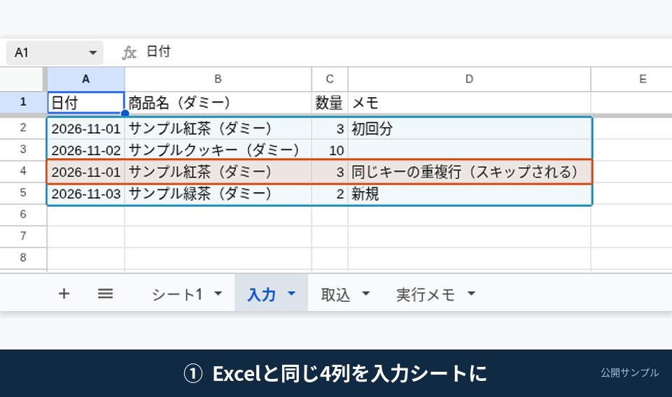

# excel-to-gas-transfer

ダミーデータをシートへ取り込み、手作業のコピーを終わらせます。



上のGIFは、デモ用アカウントでの実操作です。顧客の本番環境の画面ではありません。処理前後の比較は [docs/screenshots/excel-import-before-after.png](docs/screenshots/excel-import-before-after.png) にあります。

手元のダミー Excel / CSV と同じ列を、Google スプレッドシートの「取込」へ追記する、Google Apps Script（GAS）のサンプルです。日付と商品名が同じ行は重複としてスキップし、件数を「実行メモ」に残します。

**これは公開用のサンプルであり、受注成果物ではありません。** 実在の顧客データ、ログイン情報、API キーは含まれていません。VBA マクロの全機能を移植した実績でもありません。

出品「Excelの転記をGASに移します」の完成イメージです。新しい Google アカウントでも、15〜20分程度で同じ動きを再現できます。

デモ用アカウントで、2026-11-11 にこのリポジトリの `src/Code.gs` をそのまま実行して確認しています。1回目の取り込みは追加3・スキップ1・エラー0、2回目は追加0・スキップ4・エラー0でした。初回は必ず、自分のシートで `importFromInputSheet` を実行し、追加件数と重複スキップを確認してください。メール通知は任意です。

## できること

- 「入力」シート（Excel / CSV と同じ4列）の行を、「取込」シートの最終行へ追記する
- 重複キー（`日付` ＋ `商品名（ダミー）`）が既にある行は追加せず、スキップ件数に数える
- 実行のたびに、「実行メモ」へ追加・スキップ・エラーの件数を書く
- メニュー「転記サンプル」>「入力シートから取り込む」で、ボタン1つ相当の操作ができる
- スクリプト プロパティ `NOTIFY_TO` を入れた場合だけ、テスト用アドレスへ完了メールを1通送る

## できないこと（このサンプルの範囲外）

- Excel VBA マクロの全機能をそのまま再現すること
- ドライブ上の `.xlsx` を、追加設定なしで直接読み込むこと（手順は「入力」シートへ貼る、または `samples` と同じ内容を使う）
- kintone / Notion / 有料 API との連携
- 利用規約に反するデータ取得、ログイン越えの自動操作
- 24時間の監視や、障害の常時対応

## 列の対応

詳細は [docs/column-map.md](docs/column-map.md) を参照してください。入力の4列は次のとおりです。

| 入力列 | 取込列 | 備考 |
| --- | --- | --- |
| 日付 | 日付 | 重複判定のキー（表示文字列のまま比較） |
| 商品名（ダミー） | 商品名（ダミー） | 重複判定のキー |
| 数量 | 数量 | |
| メモ | メモ | |
| （自動） | 取込日時 | 実行した日時（Asia/Tokyo） |
| （自動） | 取込元 | `入力シート` |

サンプルファイル:

- [samples/input.csv](samples/input.csv)
- [samples/input.xlsx](samples/input.xlsx)

どちらも同じ4行です。3行目は1行目と同じキーなので、初回の取り込みではスキップされます。

## 15〜20分で再現する手順

Google アカウント（個人の無料アカウントで可）で進めます。

### 1. スプレッドシートを用意する

1. [Google スプレッドシート](https://sheets.google.com/) で新しいブックを作る
2. 拡張機能 > **Apps Script** を開く
3. このリポジトリの `src/Code.gs` の内容を、エディタのコードに貼り付ける（既存の `function myFunction` は消してよい）
4. 必要なら `src/appsscript.json` の内容を、プロジェクトの `appsscript.json` に合わせる。分からなければ、初回実行時に求められる権限で進めてもよい
5. プロジェクトを保存する

clasp を使う場合は、末尾の「clasp で使う場合」を参照してください。初めてなら、上のコピー＆ペーストの方が早いです。

### 2. シートとダミー行を作る

1. エディタ上部の関数名で `setupOnce` を選び、実行する
2. 初回は権限の確認が出る。自分のアカウントで、シートの編集を許可する（メール通知を使う場合は、メール送信も許可する）
3. ブックに「入力」「取込」「実行メモ」ができる。「入力」にはダミー4行が入る

すでに同名シートがある場合、中身は上書きしません。自分の CSV / Excel を試すときは、「入力」の1行目を同じ見出しにし、2行目以降にダミー（個人情報を除いた値）を貼り付けてください。

### 3. メニューから取り込む

1. スプレッドシートの画面に戻り、再読み込みする
2. メニュー **転記サンプル** > **入力シートから取り込む** を実行する（エディタから `importFromInputSheet` を実行しても同じです）
3. 「取込」に3行増える（紅茶・クッキー・緑茶）。同じキーの重複1行は増えない
4. 「実行メモ」に、追加3・スキップ1・エラー0 と書かれる

もう一度同じ操作をすると、追加0・スキップ4（または既存3＋入力4の重複）になり、同じ行は二重に増えません。

処理前後の実画面は、上の GIF と [docs/screenshots/excel-import-before-after.png](docs/screenshots/excel-import-before-after.png) を見てください。

説明用に組んだ図（実際の Google 画面ではありません）:

- [docs/screenshots/input-before.png](docs/screenshots/input-before.png) … 取り込み前の「入力」
- [docs/screenshots/dest-after.png](docs/screenshots/dest-after.png) … 取り込み後の「取込」（重複は含まれない）
- [docs/screenshots/log-after.png](docs/screenshots/log-after.png) … 「実行メモ」の件数

### 4. メール通知（任意）

使う場合だけ、Apps Script の「プロジェクトの設定」> **スクリプト プロパティ** に次を追加します。

| プロパティ | 値 |
| --- | --- |
| `NOTIFY_TO` | **自分で受け取れるテスト用メールアドレス** |

`example.com` などのダミーアドレスを指定しないでください。届かず、エラーになります。設定後に取り込みを実行すると、件名 `【サンプル】Excel転記の取り込みが終わりました` のメールが1通届きます。

### 5. 定期実行（オプション）

このサンプルの標準は、メニューからの手動実行です。毎日決められた時刻に回したい場合は、Apps Script の「トリガー」から `importFromInputSheet` を時間主導のトリガーに設定できます。シートの中身を入れ替えてから使う前提です。

## 失敗したとき

- 列名 typo: 「実行メモ」または実行ログに、見つからない列名が書かれます。1行目の見出しを `docs/column-map.md` に合わせてください
- 日付または商品名が空の行: その行は取り込まず、エラー件数に加算します
- メール送信の権限不足: `NOTIFY_TO` を使う場合は、権限を承認し直してください。通知が不要なら、プロパティを削除すればメールは送りません

## clasp で使う場合

```bash
npm install -g @google/clasp
cp .clasp.json.example .clasp.json
# scriptId を自分のプロジェクトに書き換える
clasp push
```

スプレッドシートにバインドしたプロジェクトを推奨します。スタンドアロンにする場合は、`CONFIG.SPREADSHEET_ID` を入れ、`appsscript.json` のスコープをスプレッドシート全般に広げる必要があります。

## ライセンス

[MIT License](LICENSE)
